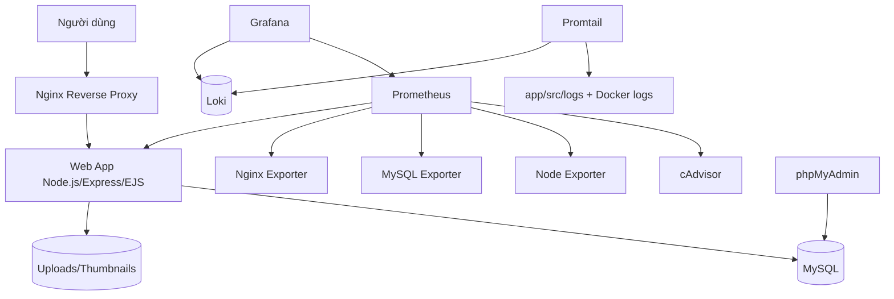

# Hệ thống Thư viện Ảnh / Gallery - DevOps Final Project
[](https://github.com/NguyenManhCuong06/DTC245200308)
[](https://nodejs.org/)
[](https://expressjs.com/)
[](https://www.mysql.com/)
[](https://www.docker.com/)
[](https://docs.docker.com/compose/)
[](https://prometheus.io/)
[](https://grafana.com/)
[](https://grafana.com/oss/loki/)
[](https://nginx.org/)

## Mục lục

- [Giới thiệu dự án](#giới-thiệu-dự-án)
- [Chức năng chính](#chức-năng-chính)
- [Kiến trúc hệ thống](#kiến-trúc-hệ-thống)
- [Công nghệ sử dụng](#công-nghệ-sử-dụng)
- [Cấu trúc thư mục](#cấu-trúc-thư-mục)
- [Yêu cầu môi trường](#yêu-cầu-môi-trường)
- [Cài đặt và khởi chạy](#cài-đặt-và-khởi-chạy)
- [Truy cập dịch vụ](#truy-cập-dịch-vụ)
- [Monitoring và Logging](#monitoring-và-logging)
- [Bảo mật và Hardening](#bảo-mật-và-hardening)
- [Kiểm thử và xác minh](#kiểm-thử-và-xác-minh)
- [Minh chứng hình ảnh](#minh-chứng-hình-ảnh)
- [Xử lý sự cố](#xử-lý-sự-cố)
- [Git workflow và đóng góp](#git-workflow-và-đóng-góp)
- [Backup và khôi phục](#backup-và-khôi-phục)
- [Hạn chế và hướng phát triển](#hạn-chế-và-hướng-phát-triển)
- [Tác giả và tài liệu tham khảo](#tác-giả-và-tài-liệu-tham-khảo)

## Giới thiệu dự án

Hệ thống Thư viện Ảnh / Gallery là ứng dụng web quản lý album ảnh, upload, phân loại và chia sẻ. Dự án triển khai đầy đủ stack DevOps gồm container hóa Docker Compose, reverse proxy Nginx (HTTPS tự ký), monitoring Prometheus + Grafana, centralized logging Loki + Promtail, MySQL + phpMyAdmin.

## Chức năng chính

- Đăng ký, đăng nhập và xác thực người dùng
- Tạo, quản lý album ảnh
- Upload ảnh với thumbnail
- Xem chi tiết ảnh và slideshow
- Gán tag, chia sẻ album có thời hạn
- Trang quản trị

## Kiến trúc hệ thống



## Công nghệ sử dụng

| Công nghệ | Phiên bản | Vai trò |
|---|---|---|
| Node.js / Express / EJS | 20.20.2-alpine / ^4.18.2 / ^3.1.9 | Web App |
| MySQL / phpMyAdmin | 8.0.46 / 5.2.3 | Database & DB UI |
| Nginx (unprivileged) | 1.31.6-alpine | Reverse Proxy |
| Prometheus / Grafana Enterprise | v3.15.0 / 13.2.3 | Monitoring |
| cAdvisor / node-exporter / mysqld-exporter / nginx-prometheus-exporter | v0.55.1 / v1.12.1 / v0.20.0 / 1.4.2 | Exporters |
| Loki / Promtail | 3.7.8 / 3.6.8 | Logging |

## Cấu trúc thư mục

```text
D:\Gallery
├── app/                # Ứng dụng Node.js/Express
├── db/init-scripts/    # init.sql, seed-demo.js, grant scripts
├── nginx/              # Cấu hình Nginx
├── prometheus/         # prometheus.yml
├── grafana/            # provisioning
├── loki/               # loki-config.yml
├── promtail/           # promtail-config.yml
├── healthcheck/        # Custom healthcheck probe
├── docs/               # Tài liệu
└── docker-compose.yml  # Orchestration
```

## Yêu cầu môi trường

- Docker Desktop với WSL 2 (Windows) hoặc Docker Engine + Docker Compose (Linux)
- Git


## Cài đặt và khởi chạy

```bash
git clone https://github.com/NguyenManhCuong06/DTC245200308.git
cd DTC245200308
cp .env.example .env
# Cấu hình biến môi trường trong .env
docker compose up -d --build
docker compose ps
docker compose exec -T web node /app/db/init-scripts/seed-demo.js  # tùy chọn
```

### Cấu hình `.env`

Sao chép `.env.example` thành `.env` và thay **toàn bộ** placeholder bằng giá trị mạnh; không dùng giá trị mẫu và không commit `.env`.

| Biến | Bắt buộc | Dùng cho |
|---|---|---|
| `MYSQL_ROOT_PASSWORD` | Có | Mật khẩu `root` của MySQL; chỉ dùng nội bộ container |
| `MYSQL_DATABASE` | Có | Tên database ứng dụng, mặc định `gallery_db` |
| `MYSQL_USER` | Có | User ứng dụng, mặc định `app_user` |
| `MYSQL_PASSWORD` | Có | Mật khẩu user ứng dụng; web và phpMyAdmin dùng giá trị này |
| `MYSQL_EXPORTER_PASSWORD` | Có | Mật khẩu user `gallery_exporter` cho monitoring |
| `GRAFANA_ADMIN_PASSWORD` | Có | Mật khẩu tài khoản `admin` của Grafana |
| `SESSION_SECRET` | Có | Khóa ký session; tối thiểu 32 ký tự |
| `DEMO_ADMIN_PASSWORD` | Không | Mật khẩu admin demo khi chạy `seed-demo.js` |
| `DEMO_USER_PASSWORD` | Không | Mật khẩu user demo khi chạy `seed-demo.js` |

`NODE_ENV=production` và các biến `DB_HOST`/`DB_USER`/`DB_PASSWORD`/`DB_NAME`/`UPLOAD_DIR` được Compose cấu hình nội bộ; không cần khai báo lại trong `.env`.

### Dừng và khởi động lại an toàn

```bash
# Dừng toàn bộ service nhưng giữ container, network và volume
docker compose stop

# Khởi động lại sau khi đã dừng
docker compose up -d

# Chỉ khởi động lại web
docker compose restart web
```

Không dùng `docker compose down -v`: tùy chọn `-v` xóa named volume, có thể làm mất dữ liệu MySQL. Chỉ dùng `docker compose down` (không có `-v`) khi thật sự cần bỏ container/network, và luôn backup trước khi bảo trì dữ liệu.

## Truy cập dịch vụ

| Dịch vụ | URL | Ghi chú |
|---|---|---|
| Gallery | https://localhost | Qua Nginx HTTPS (self-signed) |
| phpMyAdmin | http://127.0.0.1:8080 | Chỉ localhost |
| Grafana | http://127.0.0.1:3000 | admin / `GRAFANA_ADMIN_PASSWORD` (áp dụng khi volume Grafana được tạo lần đầu; volume hiện có dùng mật khẩu hiện hành) |
| Prometheus | http://127.0.0.1:9090 | Chỉ localhost |
| Loki API | http://127.0.0.1:3100 | Chỉ localhost |
| Node exporter | http://127.0.0.1:9100/metrics | Chỉ localhost; Prometheus scrape nội bộ |
| MySQL exporter | http://127.0.0.1:9104/metrics | Chỉ localhost; Prometheus scrape nội bộ |
| Nginx exporter | http://127.0.0.1:9113/metrics | Chỉ localhost; Prometheus scrape nội bộ |

## Monitoring và Logging

- Prometheus scrape: cadvisor, node-exporter, mysqld-exporter, web (web:3000/metrics), nginx-prometheus-exporter, prometheus. Kiểm tra: `curl -s http://localhost:9090/api/v1/targets?state=active` → 6 target, tất cả `up`; `curl -s "http://localhost:9090/api/v1/query?query=mysql_up"` → `1`.
- Grafana: datasource Prometheus & Loki, 5 dashboard (container, db, nginx, web, logs).
- Promtail: `docker_sd_configs` (project=gallery) + file log của ứng dụng (`job="application"`). Positions lưu trong volume `promtail_data`; log container cũ hơn 24 giờ bị bỏ để tránh lỗi `entry too far behind` khi restart.
- Nginx: `GET /metrics` bị chặn từ bên ngoài (`location = /metrics { return 403; }`), Prometheus scrape web qua mạng nội bộ.

### Truy vấn LogQL mẫu (số liệu thật, cửa sổ 24 giờ, ghi ngày 23-10-2026)

| Mục đích | Truy vấn | Số dòng |
|---|---|---|
| Tổng log mọi container | `sum(count_over_time({container=~".+"}[24h]))` | 17.388 |
| Log HTTP của ứng dụng | `sum(count_over_time({container="web"} \|= "HTTP request" [24h]))` | 10.437 |
| Log Nginx | `sum(count_over_time({container="nginx"}[24h]))` | 1.610 |
| Lỗi mức error | `sum(count_over_time({job="application"} \| json \| level="error" [24h])) or vector(0)` | 0 |
| HTTP 5xx của ứng dụng | `sum(count_over_time({container="web"} \| json \| status_code >= 500 [24h])) or vector(0)` | 3 (đều là `/health` 503 khi DB recreate) |
| Dò lỗi đăng nhập | `{container="web"} \|= "login"` | xem trực tiếp trong Grafana Explore |

```logql
{container="web"} | json | status_code >= 500
{container="nginx"} |= " 429 "
{job="application"} | json | level=~"error|warn"
```


## Bảo mật và Hardening

Đã áp dụng và kiểm chứng ngày 23-10-2026:

- Session lưu trong MySQL (bảng `sessions`), cookie tên `gallery.sid`, `HttpOnly` + `SameSite=Strict` + `Secure` khi `NODE_ENV=production`; mọi thao tác thay đổi dữ liệu đều qua POST có CSRF.
- Ảnh thuộc album private không xuất hiện trên guest home hoặc API công khai; route media/thumbnail kiểm tra quyền và trả `404` cho guest. Lỗi DB qua API được trả thông báo chung, không lộ chi tiết driver.
- Nginx: CSP, HSTS `includeSubDomains`, `Permissions-Policy`, `X-Frame-Options: DENY`, `X-Content-Type-Options: nosniff`, `Referrer-Policy`; ẩn `X-Powered-By`; rate limit `/login`, `/register` (5 request/phút, burst 5) và API (10 request/giây).
- Container: web/nginx/loki/prometheus/promtail chạy read-only + tmpfs, `cap_drop: ALL`, `no-new-privileges`; chỉ Nginx publish 80/443, các cổng còn lại bind `127.0.0.1`, MySQL không publish ra host.
- Log Docker xoay vòng `10m` × `3` file cho từng service.
- `.env` không được Git theo dõi; `.env.example` chỉ chứa giá trị mẫu.
- Quyền DB runtime của `app_user` đã thu hẹp còn `SELECT, INSERT, UPDATE, DELETE` trên `gallery_db` (không có DDL/GRANT); `gallery_exporter` có quyền monitoring riêng. Startup chỉ probe đọc.

Ngoại lệ đã kiểm tra thực tế (không ép cấu hình làm hỏng dịch vụ):

- phpMyAdmin cần `chown` lúc entrypoint và Apache cần `setuid/setgid`, nên không thể `cap_drop: ALL`/`read_only`; bù lại service chỉ bind loopback và bật `no-new-privileges`.
- Grafana cần filesystem ghi được cho plugin updater nên không đặt `read_only`; vẫn giữ `cap_drop: ALL` và `no-new-privileges`.
- CSP còn `'unsafe-inline'` cho `script-src`/`style-src` vì template EJS dùng inline script và thuộc tính `onclick`.

## Kiểm thử và xác minh

```bash
# 1. Cấu hình Compose hợp lệ
docker compose config --quiet

# 2. Trạng thái và healthcheck
docker compose ps

# 3. Test hồi quy chạy trong container (đọc DB + gọi HTTP thật, chỉ SELECT)
docker compose exec -T web node --test test/

# 4. Header bảo mật qua HTTPS
curl -k -sS -D - -o /dev/null https://localhost/ | grep -Ei 'content-security|strict-transport|permissions-policy|x-powered-by'

# 5. Rate limit đăng nhập (6 request đầu được phép; request thứ 7 trả 429)
for i in $(seq 1 7); do curl -k -s -o /dev/null -w "%{http_code}\n" https://localhost/login; done

# 6. Prometheus / Grafana
curl -s http://localhost:9090/api/v1/targets?state=active
curl -s "http://localhost:9090/api/v1/query?query=mysql_up"
```

Kết quả thực tế ngày 23-10-2026:

| Hạng mục | Kết quả |
|---|---|
| `docker compose config --quiet` | exit 0 |
| `docker compose ps` | 12/12 service `healthy` |
| `node --test test/` trong container web | 8/8 PASS |
| Kịch bản Playwright trên UI thật | 32/32 bước PASS (đăng ký, đăng nhập, album, upload, tag, tìm kiếm, chia sẻ/thu hồi, 403, 404, đăng xuất) |
| Header HTTPS | Có CSP/HSTS/Permissions-Policy; không có `X-Powered-By` |
| Rate limit `/login` | Trả 429 khi vượt ngưỡng (5r/m, burst 5) |
| Prometheus | 6/6 target UP, `mysql_up=1` |
| Grafana | 2 datasource OK, 5 dashboard |
| Loki | Truy vấn LogQL trả dữ liệu thật (xem bảng phía trên) |

## Minh chứng hình ảnh

Ảnh chụp thực tế từ hệ thống đang chạy nằm trong `docs/screenshots/`:

| File | Nội dung |
|---|---|
| `01-trang-chu.png` … `05-dang-ky.png` | Trang chủ, album, tag, đăng nhập, đăng ký |
| `06-trang-chu-da-dang-nhap.png` … `10-tim-kiem.png` | Giao diện sau đăng nhập, chi tiết album/ảnh, tìm kiếm |
| `11-tai-anh-len.png` … `13-quan-tri-admin.png` | Upload, trang 403, trang quản trị admin |
| `14-album-kiem-thu.png` … `18-trang-chia-se-cong-khai.png` | Album kiểm thử, tag, kết quả tìm kiếm, quản lý và mở link chia sẻ |
| `19-phpmyadmin.png` | phpMyAdmin, cấu trúc DB `gallery_db` |
| `20-prometheus-targets.png` | Prometheus targets |
| `21-grafana-danh-sach-dashboard.png` … `24-grafana-logs-loki.png` | Grafana dashboards và log Loki |

## Xử lý sự cố

| Hiện tượng | Nguyên nhân thường gặp | Cách xử lý |
|---|---|---|
| Web không lên, `docker compose ps` báo `unhealthy` | DB chưa sẵn sàng hoặc sai `DB_*` trong `.env` | `docker compose logs db web`; đợi healthcheck DB rồi `docker compose up -d web` |
| Trình duyệt cảnh báo chứng chỉ | Chứng chỉ tự ký | Chấp nhận cảnh báo hoặc dùng `curl -k`; không dùng cho production |
| `429 Too Many Requests` khi đăng nhập | Rate limit 5 request/phút | Đợi khoảng 1 phút rồi thử lại; không tắt rate limit khi demo |
| `502 Bad Gateway` | Web container chưa healthy hoặc vừa restart | `docker compose ps`, `docker compose logs -n 100 web nginx` |
| Grafana không có dữ liệu | Chọn sai khoảng thời gian hoặc Prometheus chưa scrape | Đặt time range 15-30 phút; kiểm tra `Targets` trong Prometheus |
| Loki báo `entry too far behind` | Promtail đọc lại log cũ sau khi mất positions | Đã xử lý bằng volume `promtail_data` + bỏ log cũ hơn 24h; nếu vẫn thấy, kiểm tra volume còn mount đúng |
| Upload báo lỗi 413 | File vượt giới hạn | Giới hạn 10 MB/ảnh trong `express-fileupload`, tối đa 10 file/lần |
| Quên mật khẩu demo | Mật khẩu lấy từ `.env` | Xem `DEMO_ADMIN_PASSWORD`/`DEMO_USER_PASSWORD` trong `.env`, không commit giá trị thật |
| phpMyAdmin không đăng nhập được | Sai user/password hoặc DB chưa healthy | Dùng `MYSQL_USER`/`MYSQL_PASSWORD` trong `.env`; kiểm tra `docker compose logs phpmyadmin` |

## Git workflow và đóng góp

```bash
git checkout -b feature/ten-tinh-nang
git add -- app/src app/test README.md
git status --short
git diff --cached
git commit -m "feat: mo ta thay doi"
git push origin feature/ten-tinh-nang
```

## Backup và khôi phục

```bash
# Sao lưu toàn bộ database (root đọc từ biến môi trường của container, không lộ mật khẩu ra ps)
docker compose exec -T db sh -c 'exec mysqldump -uroot -p"$MYSQL_ROOT_PASSWORD" --single-transaction --routines --triggers gallery_db' > gallery-db-$(date +%F).sql

# Sao lưu ảnh upload (đang mount từ host)
cp -r app/public/uploads /backup/gallery-uploads-$(date +%F)

# Khôi phục (chỉ khi đã dừng ghi dữ liệu)
docker compose exec -T db sh -c 'exec mysql -uroot -p"$MYSQL_ROOT_PASSWORD" gallery_db' < gallery-db-2026-10-23.sql
```

- Khôi phục chỉ thực hiện trên cùng schema/phiên bản MySQL; nên sao lưu trước khi khôi phục.
- Không đưa `.env`, uploads runtime, cert hoặc log vào Git.
- `SESSION_SECRET` phải có ít nhất 32 ký tự và chỉ cung cấp qua biến môi trường.

## Hạn chế và hướng phát triển

Hạn chế đã biết:

- Chứng chỉ TLS tự ký, chỉ phù hợp môi trường học tập.
- CSP còn `'unsafe-inline'` do template EJS dùng inline script và `onclick`.
- Upload chưa có rate limit riêng; hiện chỉ giới hạn kích thước và số file.
- Grafana cần filesystem ghi nên không read-only; phpMyAdmin cần `chown`/`setuid` nên không read-only hoặc `cap_drop: ALL` (xem mục Bảo mật).
- Promtail và cAdvisor cần đọc Docker socket, đây là trade-off đã biết.
- Loki đang dùng TSDB nhưng chưa bật compactor retention; dữ liệu log cũ chưa bị xoá tự động theo `table_manager` (14 ngày) như cấu hình cũ.
- Chưa có Alertmanager; cảnh báo mới ở mức dashboard.

Hướng phát triển: CA cert nội bộ, thay `'unsafe-inline'` bằng nonce, rate limit cho upload, Redis session store, Alertmanager, backup định kỳ và tự động hoá CI.


## Tác giả và tài liệu tham khảo

**Tác giả:** Nguyễn Mạnh Cường (MSSV: DTC245200308)

**Tài liệu tham khảo:** [Docker](https://docs.docker.com/), [Nginx](https://nginx.org/en/docs/), [Prometheus](https://prometheus.io/docs/), [Grafana](https://grafana.com/docs/), [Loki](https://grafana.com/docs/loki/latest/), [MySQL](https://dev.mysql.com/doc/)
