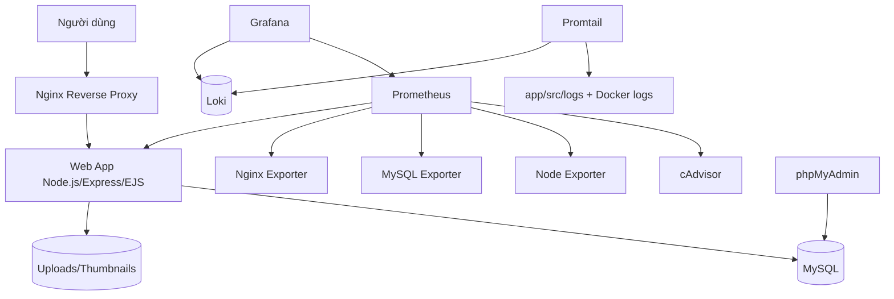

# Hệ thống Thư viện Ảnh / Gallery - DevOps Final Project

[](https://nodejs.org/)
[](https://expressjs.com/)
[](https://www.mysql.com/)
[](https://www.docker.com/)
[](https://docs.docker.com/compose/)
[](https://prometheus.io/)
[](https://grafana.com/)
[](https://grafana.com/oss/loki/)
[](https://nginx.org/)

## Mục lục

- [Giới thiệu dự án](#giới-thiệu-dự-án)
- [Chức năng chính](#chức-năng-chính)
- [Kiến trúc hệ thống](#kiến-trúc-hệ-thống)
- [Công nghệ sử dụng](#công-nghệ-sử-dụng)
- [Cấu trúc thư mục](#cấu-trúc-thư-mục)
- [Yêu cầu môi trường](#yêu-cầu-môi-trường)
- [Cài đặt và khởi chạy](#cài-đặt-và-khởi-chạy)
- [Truy cập dịch vụ](#truy-cập-dịch-vụ)
- [Monitoring và Logging](#monitoring-và-logging)
- [Bảo mật và Hardening](#bảo-mật-và-hardening)
- [Kiểm thử và xác minh](#kiểm-thử-và-xác-minh)
- [Git workflow và đóng góp](#git-workflow-và-đóng-góp)
- [Hạn chế và hướng phát triển](#hạn-chế-và-hướng-phát-triển)
- [Tác giả và tài liệu tham khảo](#tác-giả-và-tài-liệu-tham-khảo)

## Giới thiệu dự án

Hệ thống Thư viện Ảnh / Gallery là ứng dụng web quản lý album ảnh, upload, phân loại và chia sẻ. Dự án triển khai đầy đủ stack DevOps gồm container hóa Docker Compose, reverse proxy Nginx (HTTPS tự ký), monitoring Prometheus + Grafana, centralized logging Loki + Promtail, MySQL + phpMyAdmin.

## Chức năng chính

- Đăng ký, đăng nhập và xác thực người dùng
- Tạo, quản lý album ảnh
- Upload ảnh với thumbnail
- Xem chi tiết ảnh và slideshow
- Gán tag, chia sẻ album có thời hạn
- Trang quản trị
## Kiến trúc hệ thống


## Công nghệ sử dụng

| Công nghệ | Phiên bản | Vai trò |
|---|---|---|
| Node.js / Express / EJS | 20.20.2-alpine / ^4.18.2 / ^3.1.9 | Web App |
| MySQL / phpMyAdmin | 8.0.46 / 5.2.3 | Database & DB UI |
| Nginx (unprivileged) | 1.31.6-alpine | Reverse Proxy |
| Prometheus / Grafana Enterprise | v3.15.0 / 13.2.3 | Monitoring |
| cAdvisor / node-exporter / mysqld-exporter / nginx-prometheus-exporter | v0.55.1 / v1.12.1 / v0.20.0 / 1.4.2 | Exporters |
| Loki / Promtail | 3.7.8 / 3.6.8 | Logging |

## Cấu trúc thư mục

```text
D:\Gallery
├── app/                # Ứng dụng Node.js/Express
├── db/init-scripts/    # init.sql, seed-demo.js, grant scripts
├── nginx/              # Cấu hình Nginx
├── prometheus/         # prometheus.yml
├── grafana/            # provisioning
├── loki/               # loki-config.yml
├── promtail/           # promtail-config.yml
├── healthcheck/        # Custom healthcheck probe
├── docs/               # Tài liệu
└── docker-compose.yml  # Orchestration
```

## Yêu cầu môi trường

- Docker Desktop với WSL 2 (Windows) hoặc Docker Engine + Docker Compose (Linux)
- Git


## Cài đặt và khởi chạy

```bash
git clone https://github.com/NguyenManhCuong06/DTC245200308.git
cd DTC245200308
cp .env.example .env
# Cấu hình biến môi trường trong .env
docker compose up -d --build
docker compose ps
docker compose exec -T web node /app/db/init-scripts/seed-demo.js  # tùy chọn
```

## Truy cập dịch vụ

| Dịch vụ | URL | Ghi chú |
|---|---|---|
| Gallery | https://localhost | Qua Nginx HTTPS (self-signed) |
| phpMyAdmin | http://127.0.0.1:8080 | Chỉ localhost |
| Grafana | http://127.0.0.1:3000 | admin / GRAFANA_ADMIN_PASSWORD |
| Prometheus | http://127.0.0.1:9090 | Chỉ localhost |
| Loki API | http://127.0.0.1:3100 | Chỉ localhost |

## Monitoring và Logging

- Prometheus scrape: cadvisor, node-exporter, mysqld-exporter, web (web:3000/metrics), nginx-prometheus-exporter, prometheus
- Grafana: datasource Prometheus & Loki, 5 dashboard (container, db, nginx, web, logs)
- Promtail: docker_sd_configs (project=gallery) + app/src/logs/*.log (job=application). LogQL mẫu: {container="nginx"}, {container="nginx"} |= " 404 ", {job="application"} | json | level=~"error|warn"


## Bảo mật và Hardening

Non-root containers, read_only FS + tmpfs, cap_drop ALL, no-new-privileges, internal networks (backend/monitoring), chỉ bind 127.0.0.1, .env không commit, quyền DB hạn chế, healthchecks, Nginx security headers + rate limiting.


## Kiểm thử và xác minh

Tất cả dịch vụ healthy; truy cập Gallery qua HTTPS, phpMyAdmin, Prometheus targets, Grafana dashboards, Loki+LogQL.


## Git workflow và đóng góp

```bash
git checkout -b feature/ten-tinh-nang
git add .
git commit -m "feat: mo ta thay doi"
git push origin feature/ten-tinh-nang
```


## Backup và khôi phục

- Sao lưu cơ sở dữ liệu:
  ```bash
  docker compose exec -T db mysqldump -u app_user -p gallery_db > gallery-db-$(date +%F).sql
  ```
- Sao lưu thư mục upload runtime:
  ```bash
  cp -r app/public/uploads /backup/gallery-uploads
  ```
- Khôi phục chỉ thực hiện trên cùng schema/version database và dữ liệu đã dừng an toàn.
- Không đưa `.env`, uploads runtime, cert hoặc log vào Git.
- `SESSION_SECRET` phải có ít nhất 32 ký tự và chỉ cung cấp qua biến môi trường.

## Hạn chế và hướng phát triển

Hạn chế: chứng chỉ tự ký, MemoryStore session, metrics WSL2, trade-off với Docker socket access. Hướng phát triển: CA cert, Redis session store, alerting (Alertmanager), backup DB định kỳ.


## Tác giả và tài liệu tham khảo

**Tác giả:** Nguyễn Mạnh Cường (MSSV: DTC245200308)

**Tài liệu tham khảo:** [Docker](https://docs.docker.com/), [Nginx](https://nginx.org/en/docs/), [Prometheus](https://prometheus.io/docs/), [Grafana](https://grafana.com/docs/), [Loki](https://grafana.com/docs/loki/latest/), [MySQL](https://dev.mysql.com/doc/)
